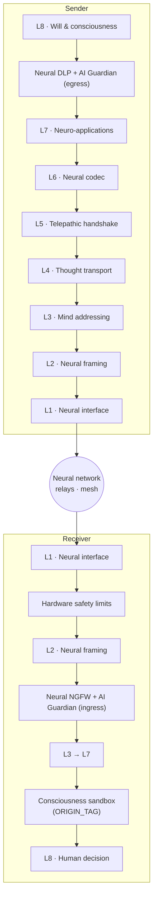

# Neuro-OSI

**A conceptual layered architecture for transmitting "thought packets" between brain-computer interfaces, secured by a Neural Next-Generation Firewall, Neural DLP, an AI Guardian, and augmented-reality integration.**

> ⚠️ **Status: speculative concept.** This repository is a thought experiment and a framework for discussion. It is not a specification of any existing product or technology. Its goal is to start a conversation about how neural communication *should* be designed and secured **before** it becomes possible, not after.

---

## Why

Brain-computer interfaces (BCIs) are moving from laboratories into clinical trials and, eventually, consumer devices. If direct brain-to-brain or brain-to-machine communication becomes practical, it will need the same things every network needs: addressing, transport, sessions, encoding, and, above all, **security**.

Computer networks learned security the hard way: protocols were designed for trust and patched for hostility decades later. The brain cannot be patched. Neuro-OSI proposes designing security into neural communication from day one, borrowing proven concepts from network engineering:

- the **OSI model** as a layered structure for neural communication;
- a **Next-Generation Firewall (NGFW)** that inspects incoming thoughts;
- **Data Loss Prevention (DLP)** that prevents leakage of private thoughts;
- an **AI Guardian** that detects novel and future threats;
- **Augmented Reality (AR)** as a data type, a security interface, and an attack surface.

## Core principles

1. **Default deny.** No unsolicited thought enters a mind.
2. **Intent before transmission.** Nothing leaves a mind without a conscious act of will.
3. **Origin is always visible.** A foreign thought must never be mistaken for one's own.
4. **The human has the final word.** AI advises and strengthens protection; it never overrides the person.
5. **Hardware sets the hard limits.** Safety boundaries are enforced physically and cannot be changed by software.
6. **Local by design.** Inspection runs on the device; raw neural data never goes to the cloud.
7. **Reality stays recoverable.** The person can always distinguish real from augmented and return to unaltered perception instantly.

## Architecture at a glance

## Documentation

| # | Document | Contents |
|---|---|---|
| 1 | [Neuro-OSI Layer Model](docs/01-neuro-osi-model.md) | The layered stack, from biology (L0) to will (L8) |
| 2 | [Thought Packet Format](docs/02-thought-packet.md) | Packet structure, header fields, transport modes |
| 3 | [Neural NGFW](docs/03-neural-ngfw.md) | Cognitive firewall: inspection, anti-injection, policies |
| 4 | [Neural DLP](docs/04-neural-dlp.md) | Classification of neural data and leakage prevention |
| 5 | [AI Guardian](docs/05-ai-guardian.md) | AI-based detection of novel threats, and how to secure the AI itself |
| 6 | [Augmented Reality](docs/06-augmented-reality.md) | AR as data, as security UI, and as an attack surface |
| 7 | [Open Problems & Ethics](docs/07-open-problems-and-ethics.md) | Unsolved challenges, neurorights, legal landscape |
| 8 | [Glossary](docs/08-glossary.md) | Terms and network-to-neural mappings |

## Contributing

Ideas, critique, threat scenarios and alternative designs are welcome. See [CONTRIBUTING.md](CONTRIBUTING.md).

## Author

**Vitalii Buchyn**

- Email: [visionregion@gmail.com](mailto:visionregion@gmail.com)
- LinkedIn: [linkedin.com/in/vitalii-buchyn-88087824](https://www.linkedin.com/in/vitalii-buchyn-88087824/)

## License

This work is licensed under the [Creative Commons Attribution 4.0 International License (CC BY 4.0)](LICENSE). You may share and adapt it, provided you give appropriate credit.
