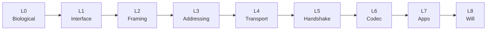

# 1. Neuro-OSI Layer Model

[← Back to README](../README.md) · [Next: Thought Packet Format →](02-thought-packet.md)

The OSI model separates networking into independent layers, each solving one problem. Neuro-OSI applies the same idea to communication between minds.

The key insight: **the hardest layer is not the physical one but the presentation layer.** Every brain encodes concepts differently, so a thought cannot simply be copied from one brain to another. It must be *translated*.

## The stack

| # | OSI layer | Neuro-OSI equivalent | Responsibility |
|---|---|---|---|
| 0 | — | **Biological** | The brain itself: neurons, spikes, neurotransmitters |
| 1 | Physical | **Neural interface** | Electrodes, optogenetics or ultrasound for reading and stimulation. Wireless link implant ↔ hub (UWB, optical) |
| 2 | Data link | **Neural framing** | Artifact filtering (muscle, eye blinks), synchronization, error correction. **NDID** (Neural Device ID) replaces the MAC address |
| 3 | Network | **Mind addressing** | **NID** (Neural ID) replaces the IP address. Routing between people, mesh relays, group multicast |
| 4 | Transport | **Thought delivery** | Reliable mode (TCP-like) for facts and instructions; best-effort mode (UDP-like) for streamed emotions and sensations. Flow control based on the receiver's cognitive load |
| 5 | Session | **Telepathic handshake** | Mutual authentication, consent, session duration, the right of either party to terminate instantly |
| 6 | Presentation | **Neural codec** | Translating "my" neural code into a shared semantic space (similar to embeddings in LLMs) and back into the receiver's code. Encryption, compression |
| 7 | Application | **Neuro-applications** | Telepathic chat, skill transfer, shared memory, collective brainstorming, rehabilitation, AR |
| 8 | (the "Layer 8" joke) | **Will & consciousness** | The human who decides what to think and what to send |

## Notable concepts

### Cognitive window size

An analogue of the TCP receive window. The receiver continuously advertises how many "semantic units" it can absorb right now. Fatigue, stress or focus on another task shrink the window. This is **backpressure at the level of the brain**: a sender cannot overwhelm a receiver's attention.

### Multimodal payload

A single thought is not one signal. It consists of several layers:

- **concept**: the semantic core;
- **imagery**: visual or sensory content;
- **affect**: the emotional coloring;
- **context**: what the thought relates to.

These can be transmitted as separate streams with different Quality of Service. For example, the meaning is delivered reliably, while the emotion is delivered on a best-effort basis.

### Layer 6 is the trust bottleneck

Because no universal neural code exists, Layer 6 will most likely require per-person calibration and an AI translator in the middle. That translator sees everything that passes through it, which makes it a critical point of trust. See [Open Problems](07-open-problems-and-ethics.md).

### Layer 8 is sovereign

Unlike in computer networks, where "Layer 8 problems" are a joke about users, here Layer 8 is the most important layer. Every other layer exists to serve the will of the person, and no layer may act against it.
