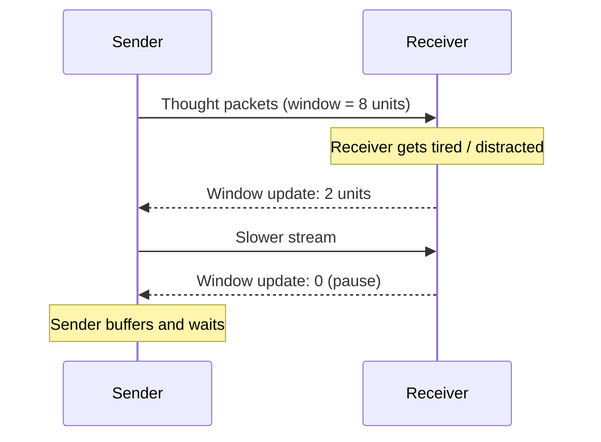

# 2. Thought Packet Format

[← Neuro-OSI Layer Model](01-neuro-osi-model.md) · [Next: Neural NGFW →](03-neural-ngfw.md)

A thought packet is the unit of neural communication. Its header carries everything the security layers need to decide whether a thought may leave one mind and enter another.

## Structure

```
┌──────────────────────────────────────────────────────┐
│ VER | TYPE (verbal/visual/emotion/motor/memory/      │
│            percept_overlay)                          │
│ SRC_NID              | DST_NID / GROUP_ID            │
│ SESSION_ID           | SEQ / FRAGMENT                │
│ TTL (hops + lifetime of the thought)                 │
│ CLASSIFICATION       (public/shared/private/...)     │
│ INTENSITY            (emotional amplitude, capped)   │
│ CONSENT_TOKEN        (receiver-signed permission)    │
│ INTENT_FLAG          (consciously sent: yes/no)      │
│ CODEC_ID             (semantic space version)        │
│ ORIGIN_TAG           ("this is a foreign thought")   │
├──────────────────────────────────────────────────────┤
│ PAYLOAD: semantic vector + context + imagery         │
├──────────────────────────────────────────────────────┤
│ SIGNATURE / HMAC (integrity, non-repudiation)        │
└──────────────────────────────────────────────────────┘
```

## Header fields

| Field | Purpose |
|---|---|
| `VER` | Protocol version |
| `TYPE` | Modality: verbal, visual, emotion, motor, memory, or AR overlay (see [AR](06-augmented-reality.md)) |
| `SRC_NID` / `DST_NID` | Neural IDs of sender and receiver; `GROUP_ID` for multicast |
| `SESSION_ID` | Binds the packet to a consented session (Layer 5) |
| `SEQ` / `FRAGMENT` | Ordering and reassembly of large thoughts |
| `TTL` | Maximum hops **and** maximum lifetime: a thought should not circulate forever |
| `CLASSIFICATION` | Sensitivity level, enforced by [Neural DLP](04-neural-dlp.md) |
| `INTENSITY` | Emotional or sensory amplitude; capped by hardware on the receiving side |
| `CONSENT_TOKEN` | Cryptographic proof that the receiver agreed to this type of content |
| `INTENT_FLAG` | Set only when the sender consciously confirmed sending |
| `CODEC_ID` | Version of the shared semantic space used for translation |
| `ORIGIN_TAG` | **Mandatory.** Marks the thought as foreign when it reaches the receiver |
| `SIGNATURE` | Integrity and authenticity of the whole packet |

## The most important field: `ORIGIN_TAG`

The brain must never confuse a foreign thought with its own. Without this tag, any incoming thought becomes a potential tool of manipulation: an implanted idea that feels self-generated is indistinguishable from free will.

The receiving device must therefore preserve `ORIGIN_TAG` all the way to conscious perception, for example as a distinct sensation, a visual marker in AR, or an explicit "message" framing. Packets without a valid `ORIGIN_TAG` are dropped.

## Transport modes

| Mode | Analogue | Used for | Guarantees |
|---|---|---|---|
| **Reliable** | TCP | Facts, instructions, memories, skills | Ordered, complete, acknowledged |
| **Streaming** | UDP / RTP | Emotions, sensations, AR scenes | Low latency, loss-tolerant |
| **Control** | ICMP | Window updates, session teardown, alerts | Highest priority, minimal payload |

A single thought can be split across modes: the concept travels reliably while its emotional coloring streams alongside it.

## Flow control: cognitive window


