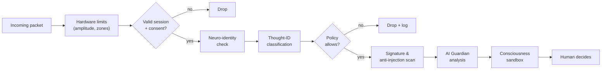

# 3. Neural NGFW: the Cognitive Firewall

[← Thought Packet Format](02-thought-packet.md) · [Next: Neural DLP →](04-neural-dlp.md)

The Neural Next-Generation Firewall inspects everything that tries to enter a mind. Most functions of a classic NGFW translate almost one-to-one.

## Function mapping

| Classic NGFW | Neural NGFW | Description |
|---|---|---|
| Stateful inspection | **Session-bound acceptance** | Only packets within an established, consented session are accepted. Unsolicited incoming thoughts are dropped by default |
| App-ID | **Thought-ID** | Classifies what is being transmitted: instruction, emotion, sensory image, motor command |
| User-ID | **Neuro-identity** | Authenticates the sender, possibly using a behavioral "neural signature" that is hard to forge |
| IPS | **Anti-injection** | Protection against brainjacking: implanted thoughts, hidden advertising, induced fear or desire, imposed decisions |
| Antivirus | **Pattern signatures** | Blocks dangerous stimulation patterns that may trigger seizures, panic attacks or pain |
| DoS protection | **Rate limiting** | Protection against a cognitive DDoS: flooding a brain with signals |
| — | **Intensity clamping** | Hard hardware limit on emotional and sensory amplitude, not changeable by software |
| Sandbox | **Consciousness sandbox** | An incoming thought is first presented to awareness as a clearly marked *message*. The person decides whether to integrate it (remember it, accept a skill) |
| Time / geo policies | **Context policies** | Nothing accepted during sleep, driving, or surgery |
| Zero Trust | **Zero Trust** | No session is trusted forever, not even with close people. Verification is continuous |

## Example policy matrix

| Relationship | Verbal | Visual | Emotion | Memory | Motor |
|---|---|---|---|---|---|
| Family | ✅ | ✅ | ✅ (capped) | ⚠️ ask | ❌ |
| Colleagues | ✅ | ✅ | ❌ | ❌ | ❌ |
| Doctor (session) | ✅ | ✅ | ⚠️ ask | ⚠️ ask | ✅ medical device only |
| Unknown sender | ❌ | ❌ | ❌ | ❌ | ❌ |
| Advertising | ❌ | ❌ | ❌ | ❌ | ❌ |

Legend: ✅ allowed · ⚠️ ask each time · ❌ blocked

## Processing pipeline

## Design rules

- **Default deny.** Silence is the default state of a mind.
- **Hardware first.** Limits that protect physical safety live below software and cannot be disabled remotely.
- **Every block is explainable.** The person can see what was blocked and why (see [AI Guardian](05-ai-guardian.md#explainability)).
- **The owner controls the policy.** Policies are set by the person only, never by a vendor, employer or state.
