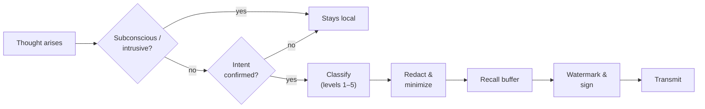

# 4. Neural DLP: Preventing Thought Leakage

[← Neural NGFW](03-neural-ngfw.md) · [Next: AI Guardian →](05-ai-guardian.md)

Outbound protection may matter even more than inbound. The brain produces an enormous stream of content that the person **never intended to send**. Neural Data Loss Prevention ensures that only deliberate thoughts leave the mind.

## Classification of neural data

| Level | Class | Examples | Handling |
|---|---|---|---|
| 1 | **Public** | What the person consciously broadcasts | Sent per policy |
| 2 | **Shared** | Content for a specific session or group | Sent only within that session |
| 3 | **Private** | Memories, passwords, PIN codes, health, finances | Sent only with explicit, per-item confirmation |
| 4 | **Intimate** | Sexuality, religion, political views, feelings about people | Blocked by default |
| 5 | **Subconscious** | Intrusive thoughts, involuntary reactions | **Never leaves the device** |

## Mechanisms

### Intent gating ("push-to-think")
Only content that passed an explicit act of will is sent. For example, a dedicated mental "confirm gesture", similar to a double click made with a thought.

### Recall buffer
A delay of a few hundred milliseconds during which the person can cancel sending, like "Undo send" in email.

### Intrusive-thought filter
Involuntary, obsessive or impulsive patterns are filtered out at Layers 2–3, before they ever reach the transport layer.

### Redaction
Faces, names, addresses and numbers unrelated to the topic are automatically masked in transmitted imagery.

### Side-channel defense
This is already a real problem, not a hypothetical one. In 2012, researchers demonstrated at USENIX Security that the P300 brain response to "familiar" stimuli, measured with consumer EEG headsets, can partially reveal a person's PIN, bank or area of residence. An application does not need to "read thoughts". It can show stimuli and measure reactions. Neural DLP must detect such **probing patterns** and block them.

### Data minimization
Applications receive only results (for example, `command: open door`), never the raw neural signal.

### Watermarking
Every transmitted thought carries an author mark, so its further distribution can be traced.

## Egress pipeline

## The corporate DLP dilemma

A company will want to protect its secrets inside an employee's head. But that is already control over the employee's thoughts. Neuro-OSI takes this position:

- corporate DLP may only restrict **what is sent to company systems**;
- it may never inspect, log or classify thoughts that are not addressed to the company;
- the employee's personal DLP always takes precedence over the corporate one.
