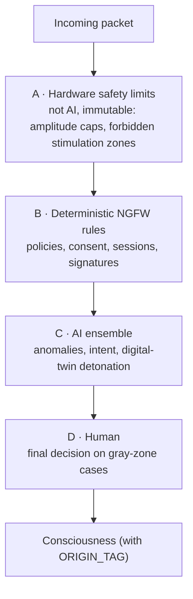

# 5. AI Guardian

[← Neural DLP](04-neural-dlp.md) · [Next: Augmented Reality →](06-augmented-reality.md)

Modern NGFW and EDR systems are moving from signatures to behavioral analysis, because new threats have no known signatures. In the neural context this matters even more: neural malware will almost certainly be novel, with no database of known samples.

The AI Guardian continuously monitors neural traffic and preemptively blocks illegitimate activity, including future viruses, malware, trojans and neuro-injections.

> **The trap:** an AI that sees and controls all of a person's thoughts becomes both the most valuable target for attackers and the most dangerous instrument of control. The architecture must account for this from the start.

## What the AI Guardian does

### Behavioral baseline
The AI learns the person's "normal" neural activity: typical thinking patterns, emotional ranges, sleep and concentration rhythms. Any externally induced deviation stands out against this profile. This is an analogue of UEBA in enterprise security.

### Intent analysis, not just content analysis
A signature catches the known. The AI evaluates **effect**: "this stream gradually shifts the emotional state toward anxiety", "this series of images resembles steering a purchase decision". This catches slow manipulations that look harmless packet by packet (an analogue of low-and-slow attacks).

### Detonation in a digital twin
An incoming thought is first fed not into the brain but into a **model of the user's brain**. The AI observes how the model reacts: panic, a changed decision, motor activation. Only then is the packet released. This is a direct analogue of sandbox detonation of email attachments.

### Predictive blocking
Using global threat intelligence, the AI anticipates new attack variants. Generative models create possible "neuro-exploits" themselves, so the detector is trained before an attacker builds them (adversarial training, AI red teaming).

### Egress protection
The same applies to DLP: the AI notices when an application is probing the person with stimuli (P300 attacks) or when requests gradually extract more than needed.

### Implant integrity
Monitoring of firmware, anomalous stimulation commands and power consumption (someone will eventually try to run a crypto miner in a brain implant).

## Layered architecture

**Principle: the AI may only strengthen protection. It may never weaken the hard rules of layers A and B.** If the AI is compromised or deceived, the hardware limits still prevent physical harm.

## Risks of the AI itself

| Risk | Mitigation |
|---|---|
| **Adversarial attacks** on the detector (a packet crafted so the AI considers it safe) | An ensemble of different models from different developers; attacking all of them at once is much harder |
| **Training poisoning** via global updates | Federated learning: only model parameters are shared, never neural data; signed updates; staged rollout |
| **False positives**: AI blocks a legitimate thought or emotion | "Warn, don't block" mode for ambiguous cases; the person can always review what was blocked |
| **AI as a tool of control** (a state or vendor changes what counts as "harmful") | Open and auditable policies; the model runs locally; no remote changes without the wearer's consent |
| **The AI sees all thoughts** | On-device processing only, no cloud; no logging of content, only threat metadata |
| **Compromise of the AI** | An independent "watcher of the watcher": a simple deterministic module that verifies the AI's integrity and behavior; a hardware kill switch |
| **Slow drift**: the AI gradually "gets used to" a manipulation and treats it as normal | A reference baseline captured in a trusted state, regularly compared against the current one |

## Explainability

The person has the right to know **why** something was blocked. For example:

> *Session from NID 4F2A blocked: over 3 minutes, the stream gradually raised your anxiety level 40% above your baseline. This matches an emotional-manipulation pattern.*
> **[Review] [Allow] [Block permanently]**

Without this, the AI Guardian turns into an opaque filter of consciousness, which is exactly what it was meant to protect against.

## Threat intelligence ecosystem

- **Neuro-CVE**: a public registry of vulnerabilities in implants and codecs.
- **Neuro-SOC**: independent centers that analyze anonymized incidents and distribute updates.
- **Honeypots**: synthetic neural profiles that lure attackers and allow new attacks to be studied before they reach real people.

## Summary

The AI is extremely valuable as a layer for detecting novel threats. But the most important architectural principle is: **the AI advises and reinforces; the final word and the hard limits belong to the human and the hardware.**
